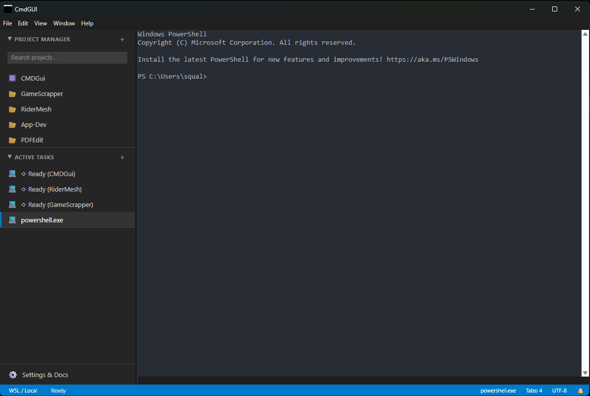
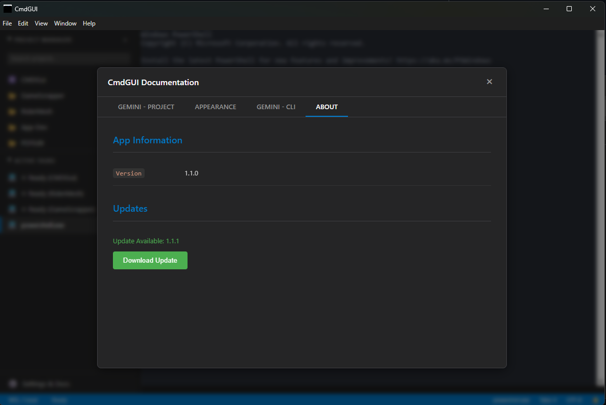

# CmdGUI

<a href="https://ko-fi.com/B0B21RXKG4"></a>

**CmdGUI** is a developer-focused workspace manager designed to streamline your command-line workflow. Built with **Tauri**, **React**, **Rust**, and **TypeScript**, it serves as a central hub for all your active projects, allowing you to manage multiple terminal sessions (PowerShell/Bash) with a persistent state that remembers your setup between launches.

## 📸 Gallery

|              Main Interface              |           Settings & Appearance            |
| :--------------------------------------: | :----------------------------------------: |
|  |  |

## Key Features

- **🖥️ Integrated Terminal Environment:** Full-featured terminal emulation using `xterm.js` and `node-pty`.
- **📂 Project Manager:** Easily add, remove, and switch between project directories from a collapsible sidebar.
- **🏷️ Smart Detection:** Automatically identifies and assigns icons to project types (React, Vue, Angular, Svelte, Node.js, Python, Rust, Go, Docker, .NET, C++, and Git).
- **📑 Multi-Tab Interface:** Restore tabs and split layouts immediately. The active tab starts its shells at launch, and restored background tabs start their shells when first opened. Running shells stay alive when you switch tabs.
- **⚡ GPU-Accelerated Rendering:** High-performance WebGL rendering pipeline for buttery-smooth terminal output.
- **💾 Persistent State:** Your open tabs, sidebar width, and added projects are saved automatically with **Automatic Session Recovery**.
- **🛡️ Admin Mode:** Built-in support for relaunching with elevated privileges for administrative tasks.

<details>
<summary><strong>FAQ: How is this different from Windows Terminal?</strong></summary>

### Core Philosophy

- **CmdGUI (Project-Centric):** Acts as a **Workspace Manager**. It organizes your workflow around specific _projects_ (e.g., "Client App", "Backend API") rather than just shells. It's like the "Terminal" panel of VS Code, but detached and persistent.
- **Windows Terminal (Shell-Centric):** A host for running command-line shells. It organizes workflow around _environments_ (PowerShell, Ubuntu) rather than folder contexts.

### User Interface

- **CmdGUI:** Features a persistent **Sidebar** with a "Project Manager". You actively "add" folders, and the app uses **Smart Detection** to assign icons based on the tech stack (React, Python, etc.).
- **Windows Terminal:** Relies on tabs and profiles. To open a project, you typically navigate manually or configure a static profile.

### Workflow & Persistence

- **CmdGUI:** **State Persistence** is key. It remembers exactly which project tabs were open and your sidebar state between launches. Terminals are spawned _from_ projects.
- **Windows Terminal:** Sessions are generally ephemeral. While it can restore tabs, it's primarily designed for fresh sessions or static startup configurations.

### Summary

**CmdGUI** is an **"IDE without the Code Editor"**—perfect for developers juggling multiple repositories who want a preserved "Command Center."
**Windows Terminal** is the **"Standard Bearer"**—the raw, high-performance engine for running shells, regardless of context.

</details>

## Tech Stack

- **Frontend:** React 19, Vite, TypeScript, react-window
- **Backend:** Tauri, Rust, portable-pty
- **Terminal:** xterm.js, WebGL/Canvas Rendering, xterm-addon-serialize

## Getting Started

### Prerequisites

- Node.js (v18 or higher recommended)
- npm
- Rust (stable toolchain)

### Installation

1.  Clone the repository.
2.  Install dependencies:

    ```bash
    npm install
    ```

### Development

To run the application in development mode (React dev server + Tauri):

```bash
npm run dev
```

Run this from the repository folder, or double-click `start.bat`. You can also use `npm run tauri -- dev`.

Development builds use a separate app identity and show **CmdGUI (Development)** as their native window title. They can run alongside the installed release. Development settings and workflow history are stored in `%APPDATA%/CmdGUI-Dev/` on Windows; the installed release continues to use `%APPDATA%/CmdGUI/`. Existing release projects are not automatically imported into the development workspace.

### Building

To build the application for production (creates a Tauri installer/executable):

```bash
npm run dist
```

After a signed Windows build, run `npm run release:prepare` to stage both installers, their signatures, the matching updater manifest, and SHA-256 checksums under `release/v<version>/`. This command checks version consistency and updates the repository's `latest.json`; it does not publish or upload a release. Install the staged production build to use your existing installed-app project settings.

## Available Commands

### Mission Control

Expand **Continue a previous Codex session** and click **Load project sessions** to use an existing thread. Review the editable context excerpt before starting, especially when a different provider is selected for planning. Select **Resume the original Codex thread for implementation** to retain its conversation history. Finish any active turn in that thread first. Excerpts contain up to four recent completed turns, capped at 12 KB, and exclude reasoning and tool output.

Mission Control text can be highlighted and copied with Ctrl+C. Its Copy buttons copy selected text within the result panel, or the displayed result, brief, or output when nothing is selected. Terminal text selection supports Ctrl+C, Ctrl+Shift+C, and context-menu Copy; copying preserves the highlight. Ctrl+C without terminal selection keeps its normal interrupt behavior.

Open **Mission Control** in the title bar, select a project and task type, then review the models and validation commands before clicking **Start task**.

| Task type | Starting route | Starting model preference |
| --- | --- | --- |
| Small, well-defined change | Codex → checks | GPT-6 Luna, medium effort |
| Complex bug or refactor | Codex → checks | GPT-6.1 Sol, high effort |
| Feature needing discovery | Codex → checks | GPT-6.1 Sol medium |
| Investigation / plan only | AGY via Gemini API → saved brief | Gemini 3.8 Flash low |

These are editable starting preferences, not benchmark rankings. **Models & routing** lets you override the route, choose specific models, and load the installed CLIs' model catalogs without running inference. Catalog entries still require account access at execution time. Settings are saved per project when a task starts; there is no silent fallback to another model.

Use **Handoff from another run or provider** to paste a reviewed plan from a native tool such as Antigravity. From a finished or interrupted run, click **Continue with…** to load an editable checkpoint containing the task, prior output, remaining work, recorded checks, and current Git status. **Review tracked changes** shows the working tree diff against HEAD, including pre-existing edits. Copy the handoff to another tool or start a new Codex run from the checkpoint. When a Codex thread is available, you can also choose to resume it. If project files change after capture, reload the checkpoint before starting.

For an automated pilot, choose **Copilot → Codex (pilot)** under **Models & routing**. Install and sign in to the GitHub Copilot CLI and make the native binary available on PATH. Copilot can read and search the project to prepare a structured brief. Codex starts after the planner exits successfully, the brief validates, and the repository still matches its original snapshot. The snapshot covers tracked and nonignored untracked files. One worker runs at a time. [GitHub Copilot CLI installation](https://docs.github.com/en/copilot/how-tos/copilot-cli/set-up-copilot-cli/install-copilot-cli)

**YOLO mode — auto-approve worker permissions** controls unattended permission handling for both workers. It initially follows the app's YOLO setting and is saved per project when starting a task. Enabled runs launch AGY with `--dangerously-skip-permissions` and Codex with `--dangerously-bypass-approvals-and-sandbox`, including resumed Codex sessions. These flags auto-approve tool permissions and disable the workers' CLI sandboxes for that invocation; they do not modify global CLI settings. With YOLO disabled, AGY uses `--sandbox` and its configured permission rules, while Codex uses `workspace-write` with approval policy `never`. Headless AGY permission denials are reported directly, and stop handoff even if AGY reports success.

Validation commands run locally in order after a completed implementation turn, even when the model reports remaining work. A failing check stops validation. **Checks passed** requires all configured checks to pass and the worker to report no remaining work. **Needs review** flags missing checks or remaining work. Investigation-only runs finish with **Brief ready**.

Runs have a configurable timeout per stage and a **Cancel run** control. Cancellation keeps edits for review. Exiting Studio leaves the run active; closing CmdGUI stops its owned worker processes. On restart, unfinished records become **Interrupted** and are never automatically relaunched.

Run history, briefs, structured implementation results, and stdout/stderr logs are saved under CmdGUI's settings directory in `workflows/<run-id>/` (normally `%APPDATA%/CmdGUI/workflows/` on Windows). Use **Open run artifacts** to inspect a run. History uses JSON files in this first version, without a separate database or server. Process output is capped at 8 MiB per stream, and the UI retains a bounded live tail.

Codex uses the native CLI's saved authentication. On Windows, CmdGUI discovers native executables on PATH and in the standard AGY and Codex install folders. Automated AGY routes use Gemini API authentication and require `GEMINI_API_KEY` in the environment when launching CMDGui. Gemini API usage is billed separately from a Google AI subscription. Use Antigravity directly and copy the resulting handoff when using a consumer subscription. [Antigravity authentication](https://antigravity.google/docs/install?tab=cli) · [Google Antigravity FAQ](https://antigravity.google/docs/faq)

Codex-reported input, cached input, and output tokens are recorded. AGY usage and subscription quota consumption are not measured in this version, so the UI does not claim total token or monetary savings. Model names shown are requested models; empirical comparisons should use representative tasks and include validation and repair time. See the [official Codex automation documentation](https://learn.chatgpt.com/docs/non-interactive-mode) and [model selection guidance](https://developers.openai.com/api/docs/guides/model-selection).

The application provides a "Settings & Docs" modal that features a tabbed interface:

- **GEMINI - Project:** Documentation for CmdGUI application shortcuts and interface navigation.
- **GEMINI - CLI:** A comprehensive list of Gemini CLI slash commands and Windows PowerShell ISE keyboard shortcuts.

## Performance checklist

| Area | Status | What to track |
| --- | --- | --- |
| Restored tabs and split panes | Optimized | Start the selected tab at launch and start saved background shells on first open. Compare private memory and process counts with 1, 10, and 30 saved tabs. |
| Startup settings and persistence | Optimized | Batch settings reads and writes. Track IPC calls and time until the active terminal appears. |
| Project sidebar | Optimized | Use one Git status command per project and refresh scripts, environment, and project type when their source files change. Track refresh time with large project lists. |
| Mission Control | Optimized | Load project-specific history summaries and poll only during active runs. Track IPC payload size as history grows. |
| Long-running terminals | Idle baseline measured | Profile tab switching and memory under sustained output. Use the process breakdown below to distinguish shell cost from renderer cost. |
| Terminal output and recovery | Release latency traced | PowerShell line editing contributes to slow command responses under the test workload. Profile output buffering and scrollback snapshots during longer sessions. |
| Frontend startup | Candidate | Measure first paint and active terminal readiness in a release build before deferring optional modules or changing fonts. |
| Large workspaces and file explorer | Candidate | Profile directory loading, project switching, and Git refresh on representative large repositories. |

The Windows startup baseline used isolated test profiles. With 30 saved tabs, the change to defer shell startup reduced combined private memory from 1,276 MiB to 272 MiB in debug builds. The updated release build used 277 MiB in the same scenario.

In a later Windows debug sample, opening all 30 saved tabs increased combined idle private memory from about 269 MiB to 1,230 MiB. PowerShell and console hosts accounted for about 885 MiB of that increase. WebView2 added about 72 MiB. These are single-machine samples.

Two Windows debug runs with 10 open PowerShell tabs completed a concurrent CMDGUI build, the test suite, and a 6,000-line output stream. Median typed-command response was 46–47 ms idle and 47–61 ms under load. The longest loaded responses were 1.29 s and 1.94 s, versus at most 112 ms idle. Median tab-switch timing was 13 ms idle and 18–19 ms under load, measured through two WebView animation frames. Command timing includes the shell and PTY round trip.

In the Windows release build with 10 tabs, the build alone peaked at 50 ms and the output stream alone peaked at 77 ms. Tests alone reproduced a 2.92 s response. About 2.90 s elapsed between CMDGui receiving the PTY write acknowledgement and PowerShell reaching the command timestamp. The combined workload peaked at 3.00 s while switching tabs. Capping Vitest at four workers did not consistently improve response times.

With a minimal PowerShell prompt, two test runs with PSReadLine active peaked at 4.04 s and 1.51 s. Running the same workload after removing PSReadLine in the disposable shell peaked at 653 ms and 92 ms. Disabling prediction alone improved the median from 180 ms to 55 ms in one comparison, while the worst response still reached 1.77 s. These samples implicate PowerShell's interactive input handling under load. CMDGui keeps the user's shell profile and line-editing settings.

## License

ISC
