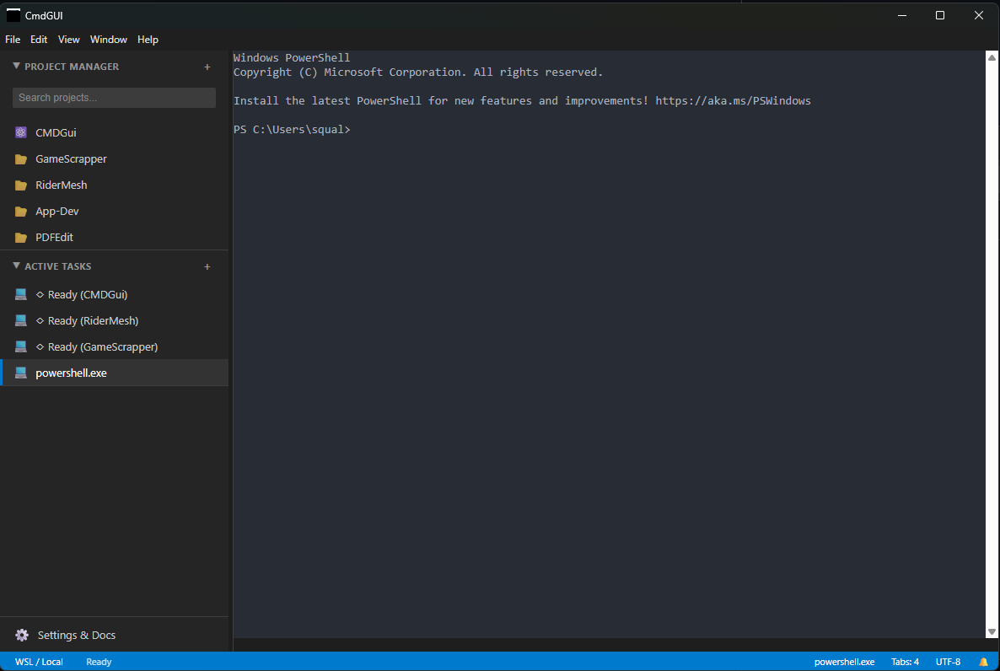
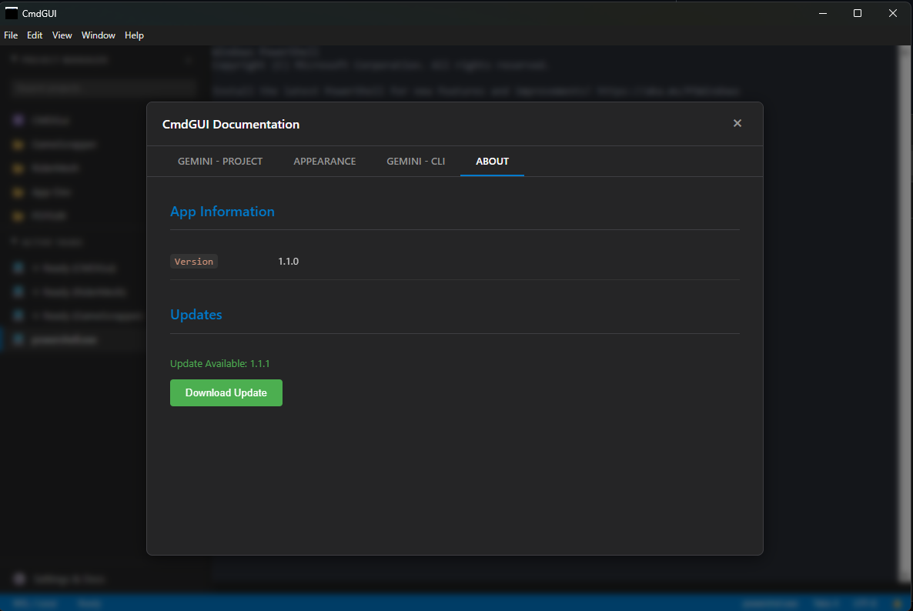

# CmdGUI

<a href="https://ko-fi.com/B0B21RXKG4"></a>

**CmdGUI** is a developer-focused workspace manager designed to streamline your command-line workflow. Built with **Tauri**, **React**, **Rust**, and **TypeScript**, it serves as a central hub for all your active projects, allowing you to manage multiple terminal sessions (PowerShell/Bash) with a persistent state that remembers your setup between launches.

## 📸 Gallery

|              Main Interface              |           Settings & Appearance            |
| :--------------------------------------: | :----------------------------------------: |
|  |  |

## Key Features

- **🖥️ Integrated Terminal Environment:** Full-featured terminal emulation using `xterm.js` and `node-pty`.
- **📂 Project Manager:** Easily add, remove, and switch between project directories from a collapsible sidebar.
- **🏷️ Smart Detection:** Automatically identifies and assigns icons to project types (React, Vue, Angular, Svelte, Node.js, Python, Rust, Go, Docker, .NET, C++, and Git).
- **📑 Multi-Tab Interface:** Run independent terminal sessions with **Tab Hibernation** (memory-saving) to support dozens of concurrent tasks.
- **⚡ GPU-Accelerated Rendering:** High-performance WebGL rendering pipeline for buttery-smooth terminal output.
- **💾 Persistent State:** Your open tabs, sidebar width, and added projects are saved automatically with **Automatic Session Recovery**.
- **🛡️ Admin Mode:** Built-in support for relaunching with elevated privileges for administrative tasks.

<details>
<summary><strong>FAQ: How is this different from Windows Terminal?</strong></summary>

### Core Philosophy

- **CmdGUI (Project-Centric):** Acts as a **Workspace Manager**. It organizes your workflow around specific _projects_ (e.g., "Client App", "Backend API") rather than just shells. It's like the "Terminal" panel of VS Code, but detached and persistent.
- **Windows Terminal (Shell-Centric):** A host for running command-line shells. It organizes workflow around _environments_ (PowerShell, Ubuntu) rather than folder contexts.

### User Interface

- **CmdGUI:** Features a persistent **Sidebar** with a "Project Manager". You actively "add" folders, and the app uses **Smart Detection** to assign icons based on the tech stack (React, Python, etc.).
- **Windows Terminal:** Relies on tabs and profiles. To open a project, you typically navigate manually or configure a static profile.

### Workflow & Persistence

- **CmdGUI:** **State Persistence** is key. It remembers exactly which project tabs were open and your sidebar state between launches. Terminals are spawned _from_ projects.
- **Windows Terminal:** Sessions are generally ephemeral. While it can restore tabs, it's primarily designed for fresh sessions or static startup configurations.

### Summary

**CmdGUI** is an **"IDE without the Code Editor"**—perfect for developers juggling multiple repositories who want a preserved "Command Center."
**Windows Terminal** is the **"Standard Bearer"**—the raw, high-performance engine for running shells, regardless of context.

</details>

## Tech Stack

- **Frontend:** React 19, Vite, TypeScript, react-window
- **Backend:** Tauri, Rust, portable-pty
- **Terminal:** xterm.js, WebGL/Canvas Rendering, xterm-addon-serialize

## Getting Started

### Prerequisites

- Node.js (v18 or higher recommended)
- npm
- Rust (stable toolchain)

### Installation

1.  Clone the repository.
2.  Install dependencies:

    ```bash
    npm install
    ```

### Development

To run the application in development mode (React dev server + Tauri):

```bash
npm run dev
```

Run this from the repository folder, or double-click `start.bat`. You can also use `npm run tauri -- dev`.

Development builds use a separate app identity and show **CmdGUI (Development)** as their native window title. They can run alongside the installed release. Development settings and workflow history are stored in `%APPDATA%/CmdGUI-Dev/` on Windows; the installed release continues to use `%APPDATA%/CmdGUI/`. Existing release projects are not automatically imported into the development workspace.

### Building

To build the application for production (creates a Tauri installer/executable):

```bash
npm run dist
```

After a signed Windows build, run `npm run release:prepare` to stage both installers, their signatures, the matching updater manifest, and SHA-256 checksums under `release/v<version>/`. This command checks version consistency and updates the repository's `latest.json`; it does not publish or upload a release. Install the staged production build to use your existing installed-app project settings.

## Available Commands

### Mission Control: AGY + Codex

In v2.6.0, expand **Continue a previous Codex session** and click **Load project sessions**. Select a session from the current local project, review the editable context excerpt, and enter your next task. AGY receives the excerpt when the run starts. Keep **Resume the original Codex thread for implementation** checked to retain Codex's full history, or uncheck it for a fresh Codex thread with only the imported excerpt and new brief. Finish any active turn in the original session first. Session browsing is read-only and runs no inference; resuming for implementation does use the selected model. Excerpts contain up to four recent completed turns, capped at 12 KB, and exclude reasoning and tool output. They are not generated summaries, so add any missing decisions or remaining work before starting.

Mission Control text can be highlighted and copied with Ctrl+C. Its Copy buttons copy selected text within the result panel, or the displayed result, brief, or output when nothing is selected. Terminal text selection supports Ctrl+C, Ctrl+Shift+C, and context-menu Copy; copying preserves the highlight. Ctrl+C without terminal selection keeps its normal interrupt behavior.

Open **Mission Control** in the title bar, select a project and task type, then review the models and validation commands before clicking **Start task**.

| Task type | Starting route | Starting model preference |
| --- | --- | --- |
| Small, well-defined change | Codex → checks | GPT-6 Luna, medium effort |
| Complex bug or refactor | Codex → checks | GPT-6.1 Sol, high effort |
| Feature needing discovery | AGY → Codex → checks | Gemini 3.8 Flash medium → GPT-6.1 Sol medium |
| Investigation / plan only | AGY → saved brief | Gemini 3.8 Flash low |

These are editable starting preferences, not benchmark rankings. **Models & routing** lets you override the route, choose specific models, and load the installed CLIs' model catalogs without running inference. Catalog entries still require account access at execution time. Settings are saved per project when a task starts; there is no silent fallback to another model.

The coordinator launches noninteractive processes instead of typing commands into interactive terminals. AGY runs in sandboxed planning mode and returns a structured brief with relevant files, evidence, implementation steps, acceptance criteria, and risks. The brief is capped at 12 KB. Codex starts automatically only after AGY exits successfully, the brief validates, and a fingerprint of the Git repository still matches. The fingerprint covers tracked and untracked nonignored files. A single worker tree runs at a time, and remaining descendants are stopped before handoff.

Validation commands run locally in order after implementation. Suggested commands are detected from the project's npm scripts where possible; edit them for your project and use commands that terminate. A failed check stops the run. **Checks passed** means every configured check exited successfully; an empty check list produces **Needs validation**. Investigation-only runs produce **Brief ready** and do not implement changes or run checks.

Runs have a configurable timeout per stage and a **Cancel run** control. Cancellation keeps edits for review. Exiting Studio leaves the run active; closing CmdGUI stops its owned worker processes. On restart, unfinished records become **Interrupted** and are never automatically relaunched.

Run history, briefs, structured implementation results, and stdout/stderr logs are saved under CmdGUI's settings directory in `workflows/<run-id>/` (normally `%APPDATA%/CmdGUI/workflows/` on Windows). Use **Open run artifacts** to inspect a run. History uses JSON files in this first version, without a separate database or server. Process output is capped at 8 MiB per stream, and the UI retains a bounded live tail.

Install and sign into both native CLIs before using the pipeline. Direct Codex tasks require only Codex; investigation-only tasks require only AGY. On Windows, CmdGUI discovers `.exe` workers on PATH and in the standard AGY/Codex install folders. AGY sandbox support depends on the installed CLI and operating system; an unsupported sandbox or unavailable model fails the stage rather than weakening its settings. Codex uses the CLI's saved authentication and workspace sandbox, with approval-requiring operations returned as failures in unattended runs.

Codex-reported input, cached input, and output tokens are recorded. AGY usage and subscription quota consumption are not measured in this version, so the UI does not claim total token or monetary savings. Model names shown are requested models; empirical comparisons should use representative tasks and include validation and repair time. See the [official Codex automation documentation](https://learn.chatgpt.com/docs/non-interactive-mode) and [model selection guidance](https://developers.openai.com/api/docs/guides/model-selection).

The application provides a "Settings & Docs" modal that features a tabbed interface:

- **GEMINI - Project:** Documentation for CmdGUI application shortcuts and interface navigation.
- **GEMINI - CLI:** A comprehensive list of Gemini CLI slash commands and Windows PowerShell ISE keyboard shortcuts.

## License

ISC
